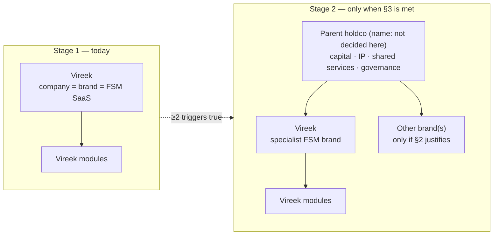
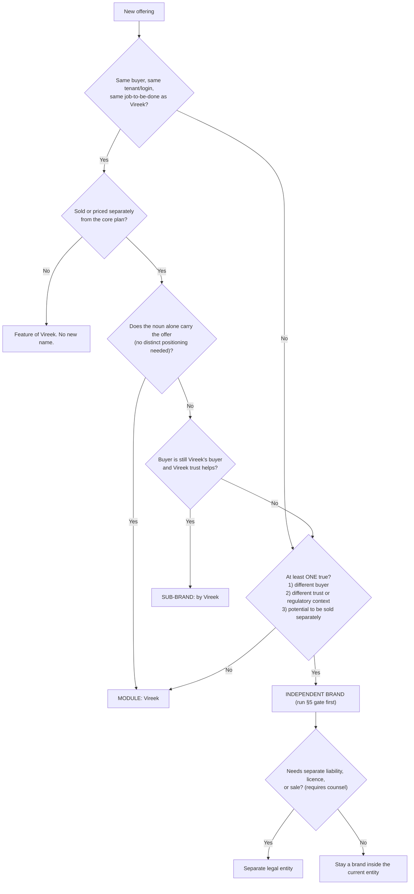

# Vireek brand architecture policy

Status: Active · Owner: Brand owner (see `BRAND_GOVERNANCE.md` §1) · Last reviewed: 2026-11-08
Related: `BRAND_GOVERNANCE.md`, `/trademark-policy`, `config.mjs → NAMING`.
Rule of use: if this document and the product disagree, fix one of them in the same PR. Every rule below is written to be checkable in review. Legal and tax statements are marked **(requires counsel)**; nothing here is legal advice.

## 1. Current state vs target state

Today Vireek is both the company and the only brand. The target is a staged architecture: Vireek remains the single brand until Stage-2 triggers (§3) are met; then a separate parent is added as a thin holding layer, and Vireek remains the specialist FSM brand.

Stage 1 rule: no parent name is used, reserved publicly, or referenced in product, marketing, or code.

## 2. The ladder and decision tree

Ladder: **product → module → sub-brand → independent brand → separate legal entity → parent holdco.** Stop at the lowest rung that works. Moving up requires a written justification in the change log (§9).

| Rung | Form | Example pattern |
|---|---|---|
| Product | Vireek core | `Vireek` |
| Module | Same buyer, same login/tenant, separately packaged | `Vireek <Noun>` |
| Sub-brand | Same buyer family, needs its own identity, still sold under Vireek terms | `<Name> by Vireek` |
| Independent brand | Vireek not in the name or marketing | `<Name>` |
| Separate legal entity | Ring-fenced liability/regulation/sale **(requires counsel)** | n/a |
| Parent holdco | See §3 | n/a |

Checkable: a PR or proposal that adds an independent brand must state which of criteria 1–3 is true and cite the evidence. "It sounds better" is not a criterion.

## 3. Stage-2 triggers (introduce the parent)

Introduce a parent only when **at least TWO** are true, each with written evidence in the change log:

- (a) A second business line with its own buyer, team, and P&L.
- (b) A planned acquisition or sale of a unit.
- (c) Investors require ring-fencing **(requires counsel)**.
- (d) Launching a regulated product that needs a separate entity **(requires counsel)**.
- (e) Customers would plausibly not buy the new product from "Vireek". Evidence must come from customer research or sales data, not opinion.

One trigger alone: do not introduce a parent. Use the ladder (§2) instead. Choosing the parent name is out of scope here and must pass §5 before any public use.

## 4. Naming rules

**Module convention:** `Vireek <Noun>` — one common English noun, Title Case, no abbreviation (e.g. the pattern, not a decided name).

**Prohibited patterns:**
- Tier or marketing suffixes as names: `Pro`, `Plus`, `Max`, `Lite`, `Ultra`, `+`.
- Version numbers, years, or dates in a brand name.
- Invented-suffix names (`-ify`, `-ly`, `-hub`, `-ai` appended to Vireek).
- `Vireek AI <X>`: AI is a capability, not a brand component.
- Two brand names combined (`Vireek <Brand>`) where `<Brand>` is itself a mark.
- Using "Vireek" for an offering that fails the §2 module test, and any name that has not passed §5.
- Misspellings, alternate casings, or logo-lockup variants of "Vireek" outside `src/components/brand/`.

**Not renamed by this policy:** the company legal name, the `vireek` product name and domains, existing shipped module names, URLs, package/bundle identifiers, API and database identifiers, and tenant data. Renaming any of these needs a separate decision and a migration plan.

## 5. Naming gate checklist (any new brand, sub-brand, or parent)

All items must be recorded as PASS with evidence before public use. Anything not completed is **UNVERIFIED**. Never claim availability from a search alone.

| # | Check | Notes |
|---|---|---|
| 1 | Trademark knockout, classes **9, 35, 36, 42, 44** | WIPO Global Brand Database, USPTO, EUIPO/TMview. Requires counsel for interpretation |
| 2 | Domain check | Primary TLD plus main market ccTLDs; registrar record attached |
| 3 | Social handles | Platforms used for B2B and recruiting |
| 4 | Native-speaker check in top markets | Meaning, pronunciation, connotation |
| 5 | Attorney clearance opinion | Requires counsel; written, dated, attached |
| 6 | Confusion check against Vireek marks and modules | Reviewer: Brand owner |
| 7 | Filing plan and owner entity for the mark | Requires counsel; see §8 |

## 6. Endorsement rules (parent name)

| Context | Parent name |
|---|---|
| Legal footer, terms, privacy policy | MAY appear |
| Trust/security page | MAY appear |
| Careers page | MAY appear |
| Investor materials | MAY appear |
| System emails (legal/billing footer line only) | MAY appear |
| Product marketing (site, ads, demos, sales decks) | MUST NOT appear |
| In-app UI chrome and onboarding | MUST NOT appear |
| Tenant-facing documents (invoices, quotes, reports, customer comms sent under a tenant's name) | MUST NOT appear |

Checkable: grep for the parent name in `src/`, `content/`, and email templates must match only the "MAY" locations. Wording of legal-entity statements: **requires counsel**.

## 7. Ownership

| | Owns |
|---|---|
| **Parent** (Stage 2) | Capital allocation · IP and trademarks · shared services · brand governance (this document) |
| **Each brand** | P&L · go-to-market · naming within §4–§5 · identity · product |
| **Shared platform layer** | Identity · billing · data · AI core · security. Operated once, consumed by all brands, never forked per brand |

Rules: a brand may not fork a shared-platform component. Tenant data stays account-scoped (`accountOwnerId`) across brands. Cross-brand data access needs an explicit, audited permission, and any cross-entity data transfer terms **(requires counsel)**.

## 8. Trademark ownership rule

At Stage 2, all marks (Vireek, modules, sub-brands, and the parent) are to be held by the holding entity and licensed to operating brands/entities. Assignment mechanics, licence terms, recordals, and tax effects **(requires counsel)**. Until Stage 2, marks stay with the current entity. No mark may be assigned, licensed, or filed without a counsel-reviewed record linked in the change log.

## 9. Change log and review cadence

**Cadence:** review quarterly (Brand owner), and immediately when any §3 trigger changes status or a new brand is proposed. Reviews check: §3 evidence, §5 records, §6 grep, §4 prohibited patterns in new UI/copy.

**Review checklist (copy into the PR/review):**
- [ ] Every new name has a §2 rung and written justification
- [ ] §5 gate recorded; unfinished items marked UNVERIFIED
- [ ] No parent name outside §6 "MAY" locations
- [ ] No prohibited pattern from §4
- [ ] Stage-2 move has ≥2 triggers with evidence
- [ ] All legal/tax statements marked "requires counsel" and reviewed by counsel

| Date | Change | Approved by |
|---|---|---|
| 2026-11-08 | Initial policy | _assign_ |
