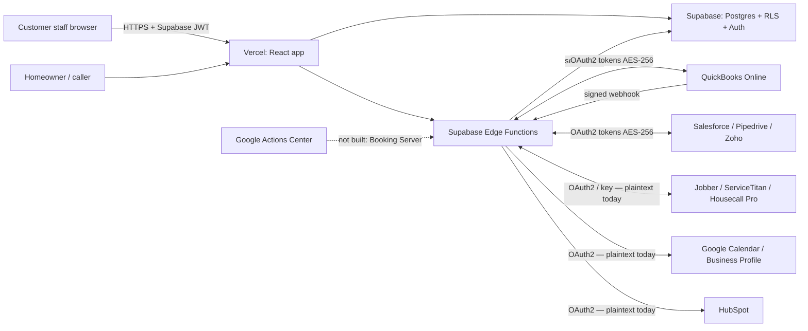

# Vireek — partner security questionnaire pack (CAIQ / SIG-Lite style)

Prepared 2026-11-03 from repository evidence only. **Evidence tags:** `[R]` verified in code/docs in the repo snapshot · `[P]` partial · `[V]` outside the repo — must be verified by an owner before sending · `[N]` not in place.
**Vireek holds no SOC 2, ISO 27001, PCI-DSS attestation or third-party penetration-test report** (see `docs/compliance/SOC2_READINESS.md`; `src/lib/complianceStatus.ts`). Do not state otherwise to any partner. Answers below must be re-confirmed by the security owner (currently unnamed) before submission.

## 1. Company & scope
- Product: multi-tenant SaaS for home-service businesses (booking, dispatch, call handling, invoicing, integrations). Hosting: Supabase (database, auth, edge functions, US) and Vercel (frontend, US) `[R]` (`src/lib/subprocessors.ts`, last updated 2026-09-12).
- Security contact & disclosure: `security.txt` (expires 2027-09-10) and `/vulnerability-disclosure` `[R]`.

## 2. Control answers

| Domain | Question (abridged) | Answer | Tag |
|---|---|---|---|
| Governance | Named security owner / formal policies | No named owner; engineering-authored control map exists | `[N]`/`[P]` |
| Governance | Independent audit (SOC 2/ISO) | None. SOC 2 readiness map only (Security, Availability, Confidentiality scope) | `[N]` |
| Governance | Penetration test | No report in repository. Answer "not yet performed / not evidenced" until one exists | `[N]` |
| IAM | Tenant isolation | Postgres RLS keyed by `get_account_owner_id()`; migration linter warns on tables without RLS; live-DB coverage query to be run | `[R]`+`[V]` |
| IAM | MFA | Available (authenticator, AAL2 enforced when enrolled); **not enforced** for owners/admins/staff | `[P]` |
| IAM | RBAC / least privilege | `profiles.role`, `team_members.permissions`, custom roles; no periodic access review | `[P]` |
| IAM | SSO/SCIM | `admin-sso`, `scim-v2` (enterprise) | `[R]` |
| IAM | Staff access to customer data | `is_vireek_staff()` gated; no JIT access, no staff-access review policy | `[P]` |
| Data | Encryption in transit | HTTPS to Supabase/Vercel; provider calls over HTTPS | `[R]`/`[V]` |
| Data | Encryption at rest — platform | Supabase-managed disk encryption | `[V]` |
| Data | Encryption of integration credentials | **QuickBooks and CRM tokens: AES-256 application-level, service-role-only tables. Jobber, ServiceTitan, Housecall Pro, HubSpot, Google tokens: NOT application-encrypted today** (planned remediation; see matrix finding 2). Do not claim blanket encryption | `[P]` |
| Data | Key management | Keys held as Supabase secrets; rotation cadence undefined | `[P]` |
| Data | Retention & deletion | `data_retention_policies`, `deletion_requests`, `data-retention-sweep`, `delete-account`; coverage of integration tables unverified | `[P]` |
| Data | Data residency | Region config in trust pack (`src/lib/trustPack/regions.ts`); production default US | `[R]`/`[V]` |
| Data | Customer data used to train AI models | Not asserted here — confirm against `src/lib/aiSecurity.ts` and AI-provider terms before answering | `[V]` |
| AppSec | Secure SDLC / CI | Lint, typecheck, tests, CodeQL, gitleaks, npm audit, Dependabot per SOC 2 map (**workflows not present in this snapshot — verify in GitHub**) | `[V]` |
| AppSec | Code review | Policy requires second reviewer for auth/RLS/billing/webhooks; no CODEOWNERS; branch protection unproven | `[P]` |
| AppSec | Secrets scanning | gitleaks (`.gitleaks.toml`) per docs | `[V]` |
| AppSec | OAuth `state` / CSRF | Signed, 10-min TTL; nonce + constant-time compare added in this change for Jobber/HubSpot (QuickBooks/CRM already) | `[R]` |
| AppSec | Webhook authentication | QuickBooks (HMAC, constant time) ✔; Stripe and others have receivers; ST/HCP/Jobber/HubSpot inbound webhooks not implemented | `[P]` |
| Logging | Audit log | `audit_log` (owner-readable, no client write); retention undefined | `[P]` |
| Logging | Error monitoring | Sentry if DSN set | `[V]` |
| Availability | Monitoring/SLO | `synthetic-probe`, `slo-evaluate`, `/status` | `[R]` |
| Availability | Backups/DR | `dr-backup-run`, `dr-restore-drill`; RTO/RPO not defined; first drill evidence pending | `[P]` |
| Incident | Incident response | `RUNBOOK` incident sections; no on-call roster/paging | `[P]` |
| Incident | Breach notification | Define timeline per contract/law (e.g. GDPR 72h) — not asserted here | `[V]` |
| Third parties | Subprocessor list & change notice | `/subprocessors` page + `subprocessor-notice-dispatch` | `[R]` |
| Privacy | DPA | `DpaContent` (Section 5 notice process) | `[R]` |
| Resilience | Rate limiting | `api-v1` 120 req/min; provider-side limits handled for QuickBooks/CRM only | `[P]` |

## 3. Architecture & data-flow map

Data categories moving to partners: customer name/phone/address, job type/time, price-book items, invoices/payments (QuickBooks), calendar events. Voice/call content is **not** sent to FSM/accounting partners by the integrations audited here (**verify** `externalJobSync.ts` payloads before stating this in a questionnaire).

## 4. Encryption & retention statements (safe to use now)
- "Integration credentials for QuickBooks and CRM connections are encrypted at the application layer (AES-256) and stored in tables inaccessible to end-user sessions."
- "Vireek does not currently hold SOC 2 or ISO 27001 certification."
Do **not** use: "all data encrypted", "SOC 2 compliant", "pen-tested".

## 5. Incident process (as documented)
Detect (synthetic probes/SLO alerts) → triage (`RUNBOOK`) → contain (revoke provider grants, rotate secrets) → notify per contract → post-mortem. Missing: named incident commander, on-call roster, tested tabletop. 

## 6. Sub-processors
Source of truth: `src/lib/subprocessors.ts` (updated 2026-09-12). Review it against actual providers (Intuit, Jobber, ServiceTitan, HubSpot, Google, Microsoft are customer-initiated connections) before attaching.
